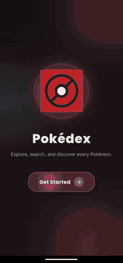
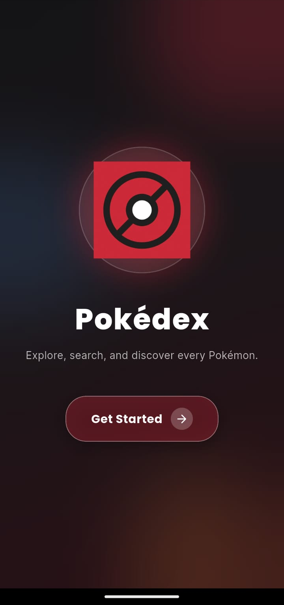
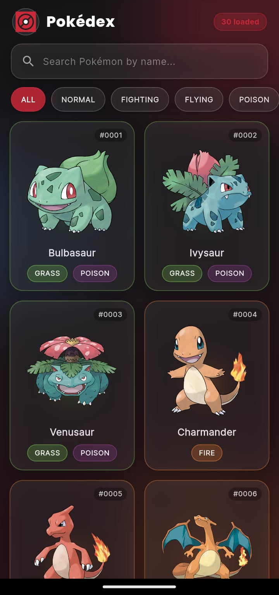
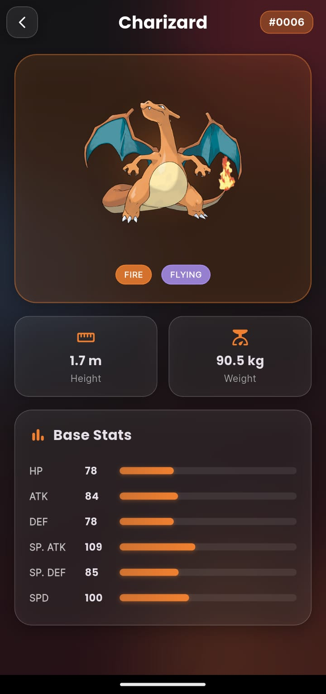
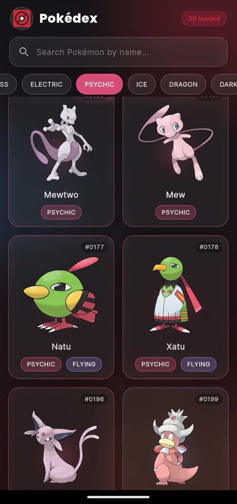

# Pokédex

A modern Pokédex app built with Flutter. It has a glassmorphism design, a clean landing screen, and infinite scrolling through **every Pokémon** in the PokéAPI, with no hardcoded limit.

## Features

- Landing screen with logo and animated entrance
- Glassmorphism UI (frosted glass cards, blurred gradient background)
- Light and dark mode, following the system setting
- Infinite scroll: loads 30 Pokémon at a time until the API has no more
- Instant search by name across all Pokémon
- Filter by type
- Detail screen with animated stat bars, height, weight and types
- Hero animations, loading skeletons, and retry on errors

## Screenshots

  

  
  
  
  

## Tech stack

- Flutter and Dart
- [PokéAPI](https://pokeapi.co) (free, no API key needed)
- `http` for network requests
- `cached_network_image` for image caching
- `google_fonts` (Poppins and Inter)
- `flutter_launcher_icons` for the app icon

## Getting started

You need the [Flutter SDK](https://docs.flutter.dev/get-started/install) installed.

    git clone https://github.com/Adityan16-adi/pokedex-flutter-app.git
    cd pokedex-flutter-app
    flutter pub get
    flutter run

To build an Android APK:

    flutter build apk --release

The APK will be at `build/app/outputs/flutter-apk/app-release.apk`.

## Project structure

    lib/
      main.dart                  App entry point
      theme/app_theme.dart       Colours, text styles, glass widgets
      models/pokemon.dart        Data models
      services/poke_api_service.dart   API calls and pagination
      screens/                   Landing, list and detail screens
      widgets/                   Pokémon card, type chips, skeleton loader
    assets/images/logo.png       App logo

## Credits

Pokémon data and artwork come from [PokéAPI](https://pokeapi.co). Pokémon and Pokémon character names are trademarks of Nintendo, Game Freak and The Pokémon Company. This is a fan-made learning project and is not affiliated with them.

## Author

Made by [Adityan](https://github.com/Adityan16-adi).

